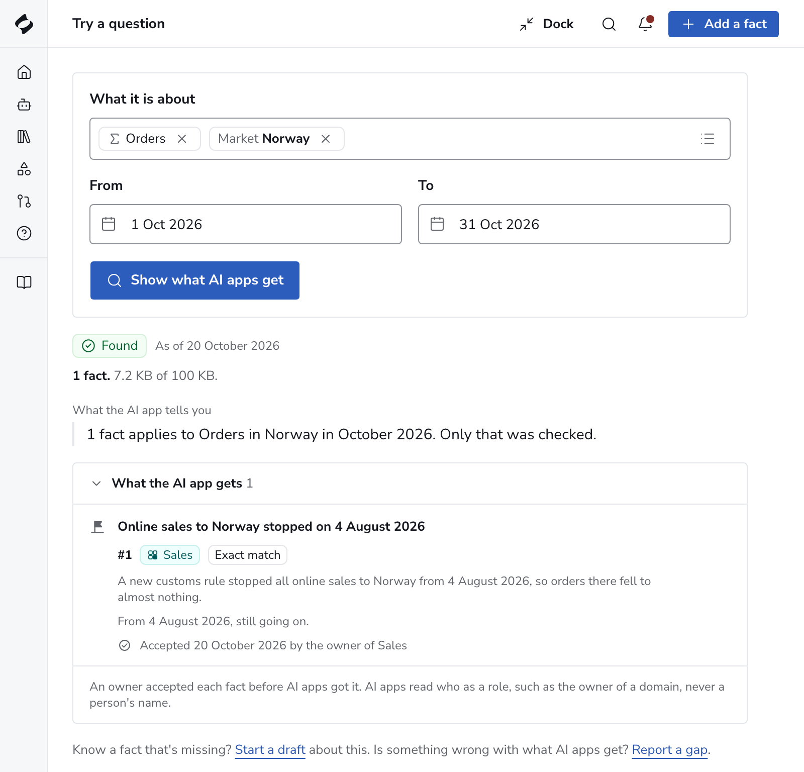
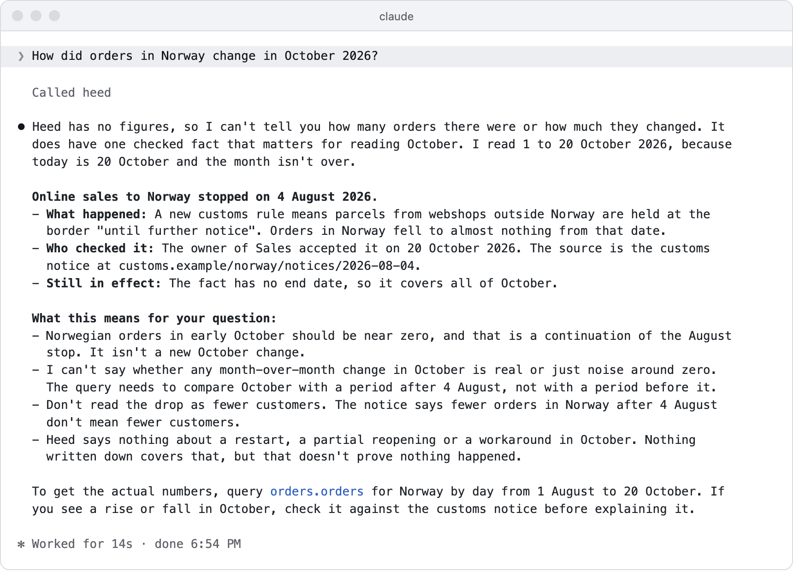
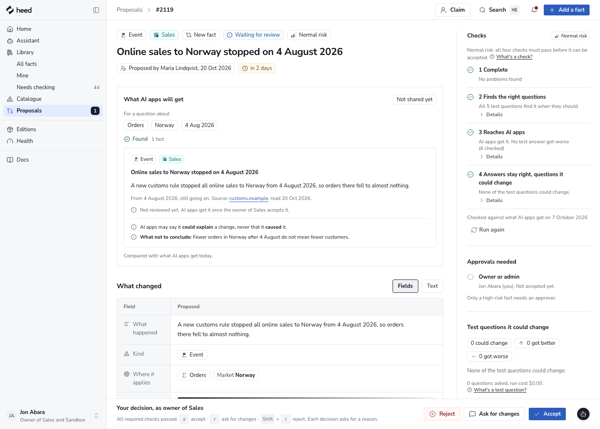
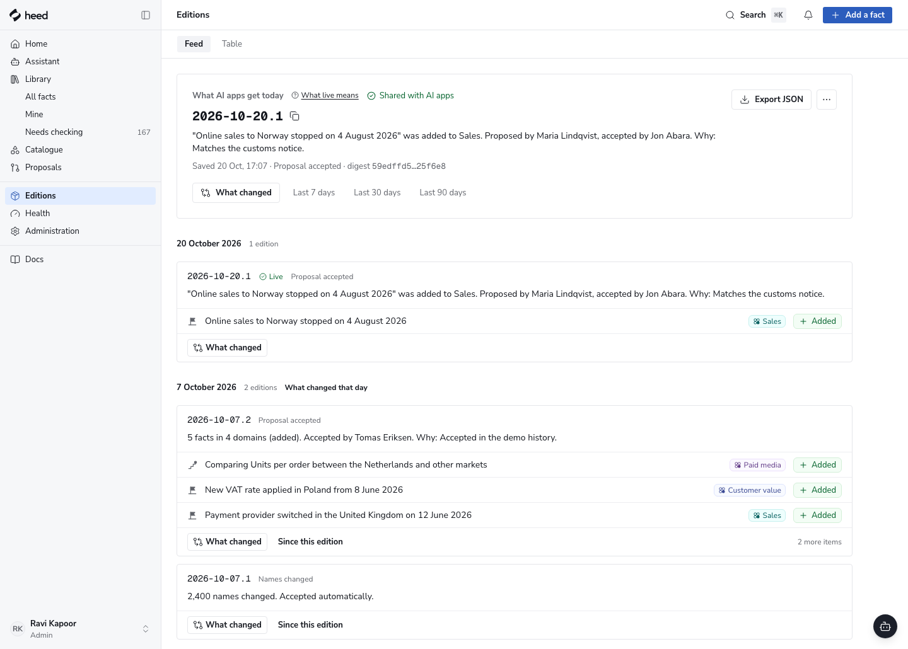
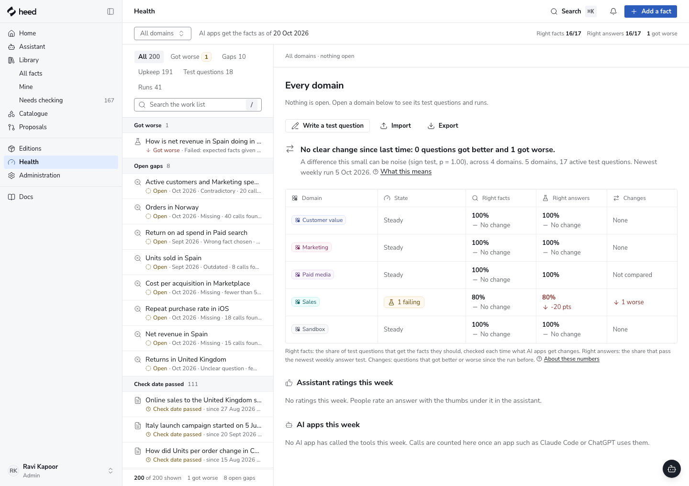

<div align="center">

<picture>
  <source media="(prefers-color-scheme: dark)" srcset="docs/images/heed-lockup-dark.svg">
  
</picture>

### The facts behind your numbers, checked before AI apps read them.

Heed is a library of facts that AI apps read before they answer questions about your data.<br>
People write down what the numbers don't show, the owner of each domain checks it,<br>
and AI apps get only what was accepted, each fact with its source.

<!-- Live demo: when the hosted mock site is up, put this at the start of the link row below:
[**Live demo**](https://LIVE-DEMO-ADDRESS) &nbsp;·&nbsp; -->

[Quick start](#quick-start) &nbsp;·&nbsp; [How it works](#how-it-works) &nbsp;·&nbsp; [Docs](#docs) &nbsp;·&nbsp; [Connect Claude Code](#connect-claude-code) &nbsp;·&nbsp; [Contributing](CONTRIBUTING.md)

[](LICENSE)
[](.nvmrc)
[](#status)

<br>

<picture>
  <source media="(prefers-color-scheme: dark)" srcset="docs/images/hero-dark.png">
  
</picture>

</div>

## Why Heed

Company data shows what happened to a number. It rarely shows why. A market closed, a tool changed how it
counts, a partner's data came in late. People know this. An AI app can't see it, so it guesses, and a guess can
sound sure of itself.

> Orders in Norway fell to almost nothing after 4 August.
>
> **Without Heed**, an AI app may blame weaker marketing and suggest you check the campaign budget.<br>
> **With Heed**, it reads a fact: _a new customs rule stopped all online sales to Norway from 4 August 2026_,
> with a link to the notice, the owner who accepted it, and a line on what not to conclude.

_An illustration of the difference, not a transcript._ The demo data belongs to an invented outdoor-gear
retailer that sells in twelve real countries.

## How it works

<p align="center">
  
</p>

1. **Write.** Anyone writes a short fact: what happened, where it applies, from when, and how we know.
2. **Review.** The owner of the domain checks it. Four checks run first, so a change doesn't make answers worse.
3. **Share.** Once accepted, AI apps get it at once, in a new edition. Every change is dated and kept.
4. **Use.** Your AI app asks Heed over [MCP](docs/help/mcp.md) and gets the facts that apply, with sources.
5. **Learn.** When no fact applies, the question counts as a gap, without recording who asked.

Heed holds facts, not numbers. [Cube](https://cube.dev) defines your metrics and returns the figures; a fact
points to them.

## Quick start

You need Docker, or Node 26 with npm.

```sh
git clone https://github.com/Fredehagelund92/heed.git && cd heed
docker compose up        # the service with demo data: http://localhost:8080
npm ci && npm run dev    # or the app on mock data, no database: http://localhost:5173
```

Both open on the demo library of an invented outdoor-gear retailer: people, domains and facts, with their
history. Sign in as any demo person. Nothing leaves your computer, and no AI service is called. Stop with
Ctrl+C; `docker compose down --volumes` also removes the data.

### Connect Claude Code

With the service running (`docker compose up`):

```sh
claude mcp add --transport http heed http://localhost:3000/mcp
```

Then run `/mcp` in Claude Code, choose **heed**, and choose **Authenticate**. Your browser opens Heed's sign-in;
choose a demo person and **Allow**. Ask _"How did orders in Norway change in October 2026?"_

<p align="center">
  <picture>
    <source media="(prefers-color-scheme: dark)" srcset="docs/images/claude-code-dark.png">
    
  </picture>
</p>

[Add to your AI app](docs/help/connect-your-ai-app.md) has the details, the [five-minute tour](docs/help/tour.md)
walks through the product, and [docs/demo.md](docs/demo.md) is the Norway story as a script.

### Use your own data

Heed reads metric and dimension names from a [Cube](https://cube.dev) model, as files, and never writes to it:

```sh
CUBE_MODEL_DIR=/path/to/your/cube/model docker compose up
```

With your own model Heed starts empty, with no demo data. Sign in as Demo Administrator and add your domains in
Administration. See [the Cube connector](docs/connectors/cube.md).

## What you get

<table>
  <tr>
    <td width="33%"></td>
    <td width="33%"></td>
    <td width="33%"></td>
  </tr>
  <tr>
    <td align="center"><sub>Review with checks</sub></td>
    <td align="center"><sub>Editions</sub></td>
    <td align="center"><sub>Health for owners</sub></td>
  </tr>
</table>

- **Five kinds of fact.** Event, note, guide, example and issue. Each says where it applies (metric, market,
  dates), links its source with one copied sentence, and says what not to conclude.
- **Owners, not a free-for-all.** Every fact belongs to one domain, and that domain's owner accepts it. A
  high-risk fact needs a second yes from an approver. Nothing reaches an AI app on its own.
- **Checked before it ships.** Four checks run on every proposal, including test questions that must still
  find the right fact. [Review a proposal](docs/help/review-a-proposal.md).
- **Editions.** AI apps read a fixed, dated set of accepted facts. Compare two editions, go back to an earlier
  one, or stop one fact, one domain or everything at once. [Editions](docs/help/editions.md).
- **An MCP server.** Ten tools are on by default, such as _Get facts for a question_, _Search facts_ and
  _Report something missing_; an admin can turn on two more. AI apps sign in as the person and see only what
  that person can read. [MCP](docs/help/mcp.md).
- **No AI picks the facts.** Rules choose what applies from the question's metrics, markets and dates, so the
  same question gets the same facts until someone accepts a change. **Try a question** shows exactly that.
- **Gaps.** Questions that found nothing are counted by topic, so people write the fact that's missing. Heed
  never records who asked.
- **Stays in step with Cube.** When a definition a fact relies on changes or disappears, the fact is flagged for
  its owner to check.
- **An assistant, Health and a history log.** Ask the assistant to draft a fact, read Health to see what needs
  an owner first, and keep a history of every change for the admin and the auditor.

## How it fits together

<p align="center">
  
</p>

| Instead of                       | What breaks                                                       | What Heed does                                                             |
| -------------------------------- | ----------------------------------------------------------------- | -------------------------------------------------------------------------- |
| A wiki or shared document        | AI apps can't see it, or read a page nobody has checked in a year | Short, dated facts with a source and an owner, delivered over MCP          |
| Notes in `CLAUDE.md` or a prompt | One copy per tool, no review, no history                          | One library for every AI app, with review, checks and a history            |
| Search over your documents       | Returns text that looks like the question, with no owner or date  | Returns the facts that apply to the metric, market and dates, or says none |
| Your semantic layer              | Defines the number, not why it moved                              | Sits beside it: Cube gives the figure, Heed gives the context              |

Heed is not a data tool: it holds no numbers and runs no queries. It is not a wiki: every fact is short, has a
source, and its owner checks it. It doesn't watch people: it counts questions by topic, not by person.

## Docs

| Use it                                                     | Run and build it                                                      |
| ---------------------------------------------------------- | --------------------------------------------------------------------- |
| [What is Heed](docs/help/what-is-heed.md)                  | [Run and operate the service](docs/operations.md): setup and settings |
| [A five-minute tour](docs/help/tour.md)                    | [MCP and API reference](docs/reference.md)                            |
| [Add your first fact](docs/help/add-your-first-context.md) | [How AI sign-in works](docs/ai-sign-in.md)                            |
| [Add to your AI app](docs/help/connect-your-ai-app.md)     | [Evaluations and the golden set](docs/evaluations.md)                 |
| [Common questions](docs/help/common-questions.md)          | [Develop Heed](docs/development.md) and [its tests](docs/testing.md)  |
| [All help pages](docs/help/README.md)                      | [Security, scanning and the restore drill](docs/security.md)          |

The help pages are also the app's own Docs, at `/docs`. [Requirements](docs/requirements.md) says what Heed must
do, and [Writing a connector](docs/connectors/authoring.md) how to read another source.

## Status

Heed is **pre-1.0**. Expect rough edges and breaking changes.

- It runs on one computer, or on one container host. Sign-in is the demo sign-in: anyone can be an admin, so
  keep it off the internet. Company sign-in is not built yet.
- Claude Code is the AI app that connects today. Other MCP apps need Heed at an address on the internet; see
  [Add to your AI app](docs/help/connect-your-ai-app.md).
- The demo runs on scripted mock models and spends nothing. The assistant and test runs can use Anthropic,
  directly or through Vercel's AI Gateway, chosen by an admin.
- Built with TypeScript on Node 26, Fastify, PostgreSQL 18, React 19 and the official MCP SDK.

## Contributing

Open an issue first for anything bigger than a small fix, then send a pull request. [CONTRIBUTING.md](CONTRIBUTING.md)
says how, and `npm run check` runs the type check, lint, format check and unit tests. Please follow the
[code of conduct](CODE_OF_CONDUCT.md).

## Security

Please report a security problem privately, through GitHub's private vulnerability reporting, not in a public
issue. [SECURITY.md](SECURITY.md) says how and what happens next.

## License

[Apache License 2.0](LICENSE). You keep the copyright in your contributions.
