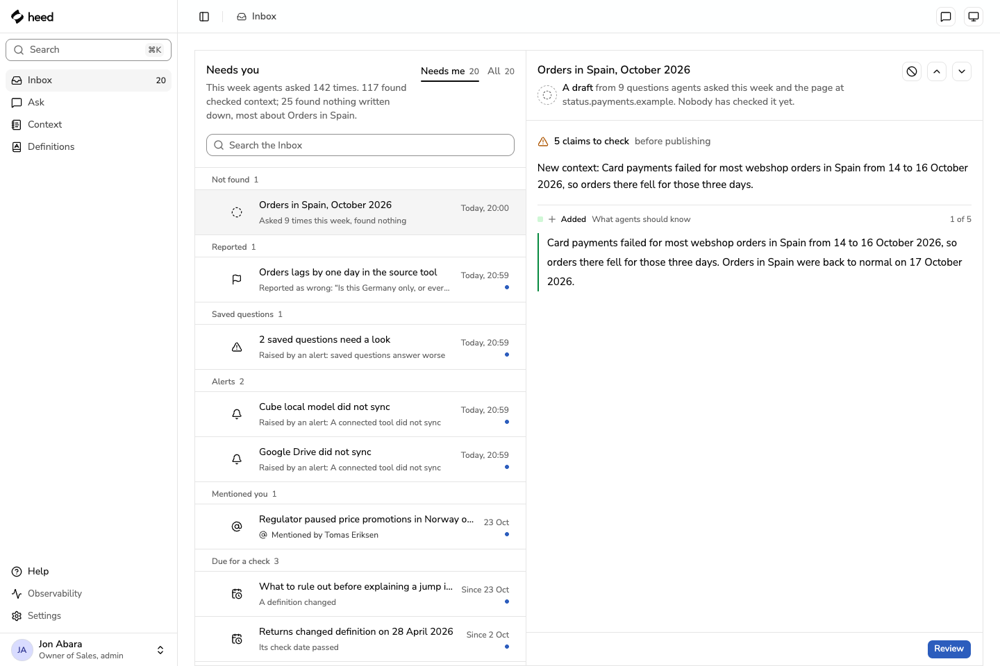
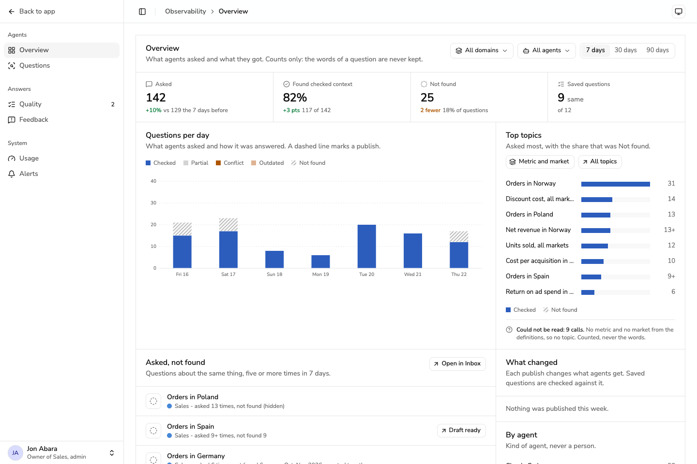

<div align="center">

<picture>
  <source media="(prefers-color-scheme: dark)" srcset="docs/images/heed-lockup-dark.svg">
  
</picture>

### The context behind your numbers, checked before AI agents read them.

Heed is a library of checked context that AI agents read before they answer questions about your data.<br>
People write down what the numbers don't show, the owner of each domain checks it and publishes it,<br>
and agents get only what was published, each item with its source.

<!-- Live demo: when the hosted mock site is up, put this at the start of the link row below:
[**Live demo**](https://LIVE-DEMO-ADDRESS) &nbsp;·&nbsp; -->

[Quick start](#quick-start) &nbsp;·&nbsp; [How it works](#how-it-works) &nbsp;·&nbsp; [Docs](#docs) &nbsp;·&nbsp; [Connect Claude Code](#connect-claude-code) &nbsp;·&nbsp; [Contributing](CONTRIBUTING.md)

[](LICENSE)
[](.nvmrc)
[](#status)

<br>

<picture>
  <source media="(prefers-color-scheme: dark)" srcset="docs/images/hero-dark.png">
  
</picture>

</div>

## Why Heed

Company data shows what happened to a number. It rarely shows why. A market closed, a tool changed how it
counts, a partner's data came in late. People know this. An agent can't see it, so it guesses, and a guess can
sound sure of itself.

> Orders in Norway fell to almost nothing after 4 August.
>
> **Without Heed**, an agent may blame weaker marketing and suggest you check the campaign budget.<br>
> **With Heed**, it reads a context item: _a new customs rule stopped all online sales to Norway from 4 August 2026_,
> with a link to the notice, the owner who published it, and a line on what not to conclude.

_An illustration of the difference, not a transcript._ The demo data belongs to an invented outdoor-gear
retailer that sells in twelve real countries.

## How it works

1. **Write.** Anyone writes a short context item: what happened, where it applies, from when, and how we know.
   An agent or an integration can send a suggestion too.
2. **Review.** The owner of the domain sees it in the Inbox. The review shows exactly what changes, whether
   the claims match the source, and what agents would say before and after. The owner publishes it, or
   returns it with a note.
3. **Agents read.** Your agent asks Heed over [MCP](docs/help/how-agents-use-it.md) and gets the items that
   apply, with sources, and an answer line first.
4. **Gaps come back.** A question that keeps finding nothing becomes a Not found card in the owner's Inbox,
   counted by topic, never by who asked.

Heed holds context, not numbers. [Cube](https://cube.dev) defines your metrics and returns the figures; a context
item points to them.

## Quick start

You need Docker, or Node 26 with npm.

```sh
git clone https://github.com/Fredehagelund92/heed.git && cd heed
docker compose up        # the service with demo data: http://localhost:8080
npm ci && npm run dev    # or the app on mock data, no database: http://localhost:5173
```

Both open on the demo of an invented outdoor-gear retailer: people, domains and context items, with their
history. Sign in as any demo person. Nothing leaves your computer, and no AI service is called. Stop with
Ctrl+C; `docker compose down --volumes` also removes the data.

### Connect Claude Code

With the service running (`docker compose up`):

```sh
claude mcp add --transport http heed http://localhost:3000/mcp
```

Then run `/mcp` in Claude Code, choose **heed**, and choose **Authenticate**. Your browser opens Heed; choose a
demo person and **Allow**. Ask _"How did orders in Norway change in October 2026?"_

<p align="center">
  <picture>
    <source media="(prefers-color-scheme: dark)" srcset="docs/images/claude-code-dark.png">
    
  </picture>
</p>

[Connect an agent](docs/help/connect-an-agent.md) has the details for Claude Code and other agents, and
[Get started](docs/help/get-started.md) walks through a first answer.

### Use your own data

Heed reads metric and dimension names from a [Cube](https://cube.dev) model, as files, and never writes to it:

```sh
CUBE_MODEL_DIR=/path/to/your/cube/model docker compose up
```

With your own model Heed starts empty, with no demo data. Sign in as the administrator in
`db/seed/people.local.yml` and add your domains in Settings, under Domains and owners. See
[the Cube connector](docs/connectors/cube.md).

## What you get

<table>
  <tr>
    <td width="33%"></td>
    <td width="33%"></td>
    <td width="33%"></td>
  </tr>
  <tr>
    <td align="center"><sub>One Inbox for owners</sub></td>
    <td align="center"><sub>Review with what agents will say</sub></td>
    <td align="center"><sub>Observability, counts only</sub></td>
  </tr>
</table>

- **Four kinds of context.** Event, Warning, Rule and Guide. Each says where it applies (metric, market,
  dates), links its source with one copied sentence, and says what not to conclude.
- **Owners, not a free-for-all.** Every context item belongs to one domain, and that domain's owners publish
  it. A draft, a suggestion or a comment never reaches an agent.
- **Checked before it ships.** The review compares the claims with the source, shows a clash with live
  context, and runs the question agents asked against the draft. [Review a suggestion](docs/help/review-a-suggestion.md).
- **Six answer lines.** Every answer, for an agent and for a person, starts with one: Checked, Partial, Not found,
  Conflict, Outdated or Not checked. [Answer lines](docs/help/answer-lines.md).
- **An MCP server.** Six tools: `get_context`, `find_context`, `read_context`, `report`, `suggest_context` and
  `get_related`. Agents sign in as the person and see only what that person can read.
  [Agent tools](docs/help/tools.md).
- **No AI picks the context.** Rules choose what applies from the question's metrics, markets and dates, so the
  same question gets the same items until an owner publishes a change. Ask shows exactly that.
- **Gaps and saved questions.** Questions that found nothing are counted by topic, so people write what's
  missing. Saved questions are answered again after every change, so a publish that makes an answer worse is
  seen at once. Heed never records who asked.
- **Stays in step with Cube.** When a definition an item relies on changes or disappears, the item is marked for
  its owner to check.

## How it fits together

<p align="center">
  
</p>

| Instead of                       | What breaks                                                      | What Heed does                                                                 |
| -------------------------------- | ---------------------------------------------------------------- | ------------------------------------------------------------------------------ |
| A wiki or shared document        | Agents can't see it, or read a page nobody has checked in a year | Short, dated context with a source and an owner, delivered over MCP            |
| Notes in `CLAUDE.md` or a prompt | One copy per tool, no review, no history                         | One library for every agent, with review, checks and a history                 |
| Search over your documents       | Returns text that looks like the question, with no owner or date | Returns the context that applies to the metric, market and dates, or says none |
| Your semantic layer              | Defines the number, not why it moved                             | Sits beside it: Cube gives the figure, Heed gives the context                  |

Heed is not a data tool: it stores no numbers. When an admin switches figures on for an integration, Ask reads
one figure from it when someone asks, and keeps it nowhere. It is not a wiki: every context item is short, has a
source, and its owner checks it. It doesn't watch people: it counts questions by topic, not by person.

## Docs

| Use it                                                  | Run and build it                                                      |
| ------------------------------------------------------- | --------------------------------------------------------------------- |
| [Get started](docs/help/get-started.md)                 | [Run and operate the service](docs/operations.md): setup and settings |
| [Write context](docs/help/write-context.md)             | [MCP and API reference](docs/reference.md)                            |
| [Review a suggestion](docs/help/review-a-suggestion.md) | [How AI sign-in works](docs/ai-sign-in.md)                            |
| [Connect an agent](docs/help/connect-an-agent.md)       | [Evaluations and the golden set](docs/evaluations.md)                 |
| [Privacy](docs/help/privacy.md)                         | [Develop Heed](docs/development.md) and [its tests](docs/testing.md)  |
| [All help pages](docs/help/README.md)                   | [Security, scanning and the restore drill](docs/security.md)          |

The help pages are also the app's own Docs, at `/docs`, and a static site (`npm run docs:build`).
[Requirements](docs/requirements.md) says what Heed must do, and [Writing a connector](docs/connectors/authoring.md)
how to read another source.

The [documentation index](docs/README.md) lists every page. The [product page](docs/product.md) and the
[design contract](docs/design/design-contract.md) say what the Heed v1 web app is and how it looks.

[The clickable mockup](apps/mockup/README.md) is the acceptance specification the app is changed to match.

## Status

Heed is **pre-1.0**. Expect rough edges and breaking changes.

- It runs on one computer, or on one container host. `docker compose up` uses the demo sign-in: anyone can be an
  admin, so keep it off the internet. Company sign-in with OpenID Connect is in
  [How AI sign-in works](docs/ai-sign-in.md).
- Agents on your computer connect today. Agents that run in the cloud need Heed at an address on the internet;
  see [Connect an agent](docs/help/connect-an-agent.md).
- The demo runs on scripted mock models and spends nothing. Ask's words and the test runs can use Anthropic,
  directly or through Vercel's AI Gateway, chosen by an admin.
- Built with TypeScript on Node 26, Fastify, PostgreSQL 18, React 19 and the official MCP SDK.

## Contributing

Open an issue first for anything bigger than a small fix, then send a pull request. [CONTRIBUTING.md](CONTRIBUTING.md)
says how, and `npm run check` runs the type check, lint, format check and unit tests. Please follow the
[code of conduct](CODE_OF_CONDUCT.md).

## Security

Please report a security problem privately, through GitHub's private vulnerability reporting, not in a public
issue. [SECURITY.md](SECURITY.md) says how and what happens next.

## License

[Apache License 2.0](LICENSE). You keep the copyright in your contributions.
