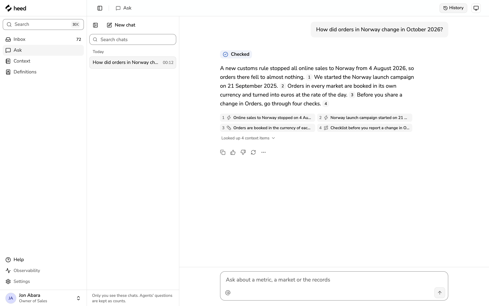
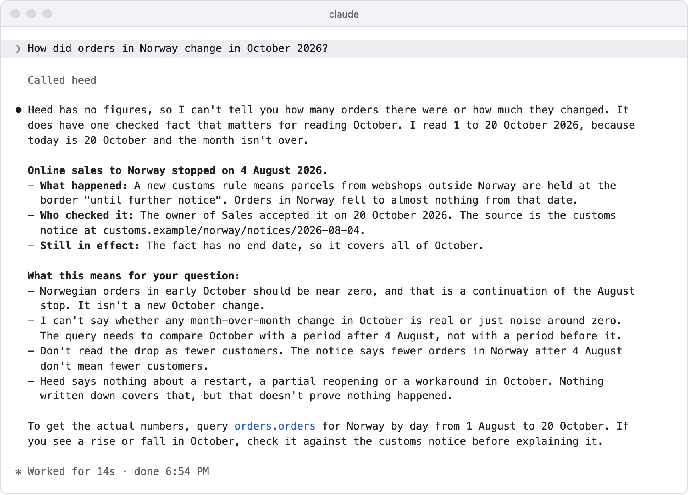
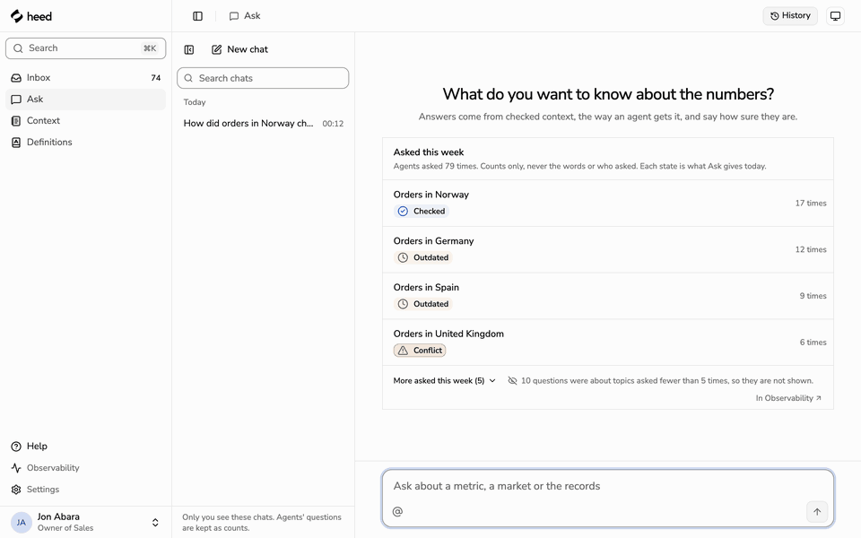
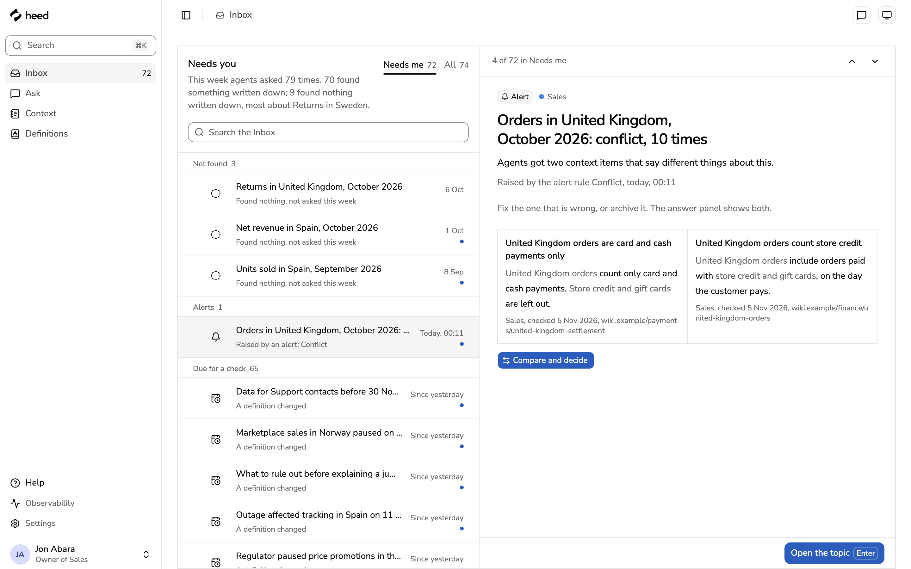
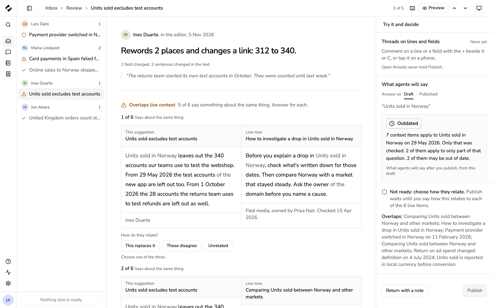
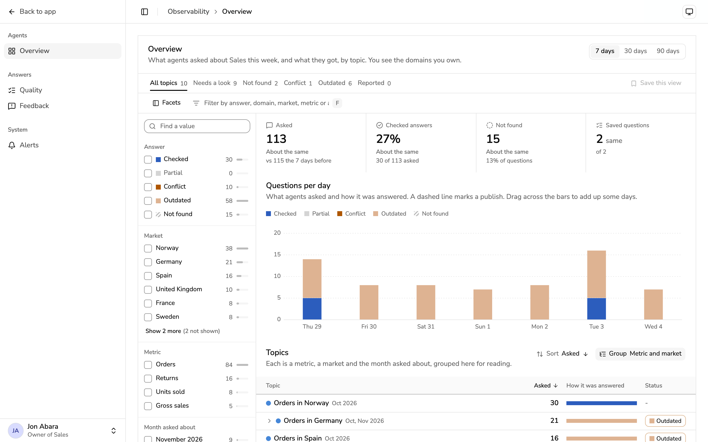

<div align="center">

<picture>
  <source media="(prefers-color-scheme: dark)" srcset="docs/images/heed-lockup-dark.svg">
  
</picture>

### Stop AI agents misreading your numbers.

Heed is a reviewed context layer for analytics teams and their agents.<br>
The people who own the data write down what the numbers don't show,<br>
and agents read it over MCP before they answer, with its source and its owner.

<!-- Live demo: when the hosted demo is up, put this at the start of the link row below:
[**Live demo**](https://LIVE-DEMO-ADDRESS) &nbsp;·&nbsp; -->

[Quick start](#quick-start) &nbsp;·&nbsp; [Proof](#proof) &nbsp;·&nbsp; [How it works](#how-it-works) &nbsp;·&nbsp; [Status](#status) &nbsp;·&nbsp; [Docs](#docs) &nbsp;·&nbsp; [Contributing](CONTRIBUTING.md)

[](LICENSE)
[](.nvmrc)
[](#status)

<br>



</div>

## Why Heed

Your metric has a definition. Why it moved doesn't. A market closed, a tool changed how it counts, a
partner's data came in late. Your analytics team knows this. An agent reading the warehouse or the
semantic layer can't see it, so it guesses, and a guess can sound sure of itself.

> Orders in Norway fell to almost nothing after 4 August.
>
> **Without Heed**, an agent may blame weaker marketing and suggest you check the campaign budget.<br>
> **With Heed**, it reads a context item: _a new customs rule stopped all online sales to Norway from 4 August 2026_,
> with a link to the notice, the owner who published it, and a line on what not to conclude.

_An illustration of the difference, not a transcript._ The demo data belongs to an invented outdoor-gear
retailer that sells in twelve real countries.

## Proof

Each of these is held by a test in this repository, so you can read it, run it, or try it on the demo.

| What Heed promises                         | What shows it                                                                                                                                                                                                 |
| ------------------------------------------ | ------------------------------------------------------------------------------------------------------------------------------------------------------------------------------------------------------------- |
| Agents read only what an owner published   | The database role that serves agents can't read the table of versions, drafts included: `permission denied` ([`tests/integration/mcp.test.ts`](tests/integration/mcp.test.ts))                                |
| The answer above is real                   | CI starts the demo, asks that question in a browser and expects **Checked** with the customs rule ([`tests/e2e-seed/demo.spec.ts`](tests/e2e-seed/demo.spec.ts))                                              |
| The right context gets delivered           | All 53 questions of the [golden set](db/seed/golden-set.yml) run in CI with no model, and each must get the items it expects ([`tests/integration/golden-set.test.ts`](tests/integration/golden-set.test.ts)) |
| Nothing is filled in when nothing is known | Every answer starts with one of six [answer lines](docs/help/answer-lines.md). Golden questions with nothing written down must come back Not found                                                            |

Heed doesn't yet have a measured number for how much better an agent answers with it than without it.
[Status](#status) says what is and isn't done.

## How it works

1. **Write.** Anyone writes a short context item: what happened, where it applies, from when, and how we know.
   An agent or an integration can send a suggestion too.
2. **Review.** The owner of the domain sees it in the Inbox. The review shows exactly what changes, whether
   the claims match the source, and what agents would say before and after. The owner publishes it, or
   returns it with a note.
3. **Agents read.** Your agent asks Heed over [MCP](docs/help/how-agents-use-it.md) and gets the items that
   apply, with sources, and an answer line first.
4. **Gaps come back.** A question that keeps finding nothing becomes a Not found card in the owner's Inbox,
   counted by topic, never by who asked.

Heed holds context, not numbers. Your semantic layer defines the metrics and returns the figures; a context item
points to them. Heed reads definitions from [Cube](docs/connectors/cube.md) and
[dbt MetricFlow](src/connectors/dbt-metricflow/README.md), and turns documents from Markdown in Git and Google
Drive into suggestions for owners. [Build a connector](docs/connectors/authoring.md) says how to add another tool.

## Quick start

You need Docker:

```sh
git clone https://github.com/Fredehagelund92/heed.git && cd heed
docker compose -f compose.yaml -f compose.images.yaml up
```

The first start pulls the published images and loads the demo, which takes about two minutes. Then open
<http://localhost:8080> and sign in as any demo person: Jon Abara owns Sales, Ravi Kapoor is the admin.

The demo is an invented outdoor-gear retailer: people, domains and context items, with their history,
suggestions waiting for review and what agents asked over the past weeks. Nothing leaves your computer, and no
AI service is called. Stop with Ctrl+C; `docker compose down --volumes` also removes the data.

Two other ways in:

- **No Docker, under a minute.** With Node 26, `npm ci && npm run dev` opens the app on mock data at
  <http://localhost:5173>. It has no database and no MCP server.
- **The code in this checkout.** `docker compose up` builds the images here, which takes far longer. The
  published images are the latest release, so use this for anything merged since.

To choose how to run Heed for your own team, see [Where to run Heed](docs/where-to-run.md). To keep it running
here, back it up, upgrade it or roll an upgrade back, see [Self-host Heed on one computer](docs/self-hosting.md).
That is for local evaluation, not for production use.

`compose.yaml` runs the service in development mode (`NODE_ENV=development`) for the demo's people picker,
where anyone can sign in as anyone. The service image on its own starts in production mode, with company
sign-in: see [Run the image in production mode](docs/operations.md#run-the-image-in-production-mode).

### Connect Claude Code

With the demo running:

```sh
claude mcp add --transport http heed http://localhost:3000/mcp
```

Then run `/mcp` in Claude Code, choose **heed**, and choose **Authenticate**. Your browser opens Heed; choose a
demo person and **Allow**. Ask _"How did orders in Norway change in October 2026?"_

<p align="center">
  
</p>

[Connect an agent](docs/help/connect-an-agent.md) has the details for Claude Code and other agents, and
[Get started](docs/help/get-started.md) walks through a first answer.

### Use your own data

Heed reads metric and dimension names from your semantic layer, and never writes to it. For a
[Cube](https://cube.dev) model, name its folder:

```sh
CUBE_MODEL_DIR=/path/to/your/cube/model docker compose -f compose.yaml -f compose.images.yaml up
```

This runs the published images, as the Quick start does; `docker compose up` alone builds them from this
checkout, which takes much longer. With your own model Heed starts empty, with no demo data. Sign in as Ravi Kapoor, the administrator in
`db/seed/people.local.yml`, and follow the setup checklist in the Inbox: add your domains, then publish the
names each read makes, on one card. Your context applies to those names. On a Mac the folder must be one Docker shares, or Heed refuses to start and says so. See
[the Cube connector](docs/connectors/cube.md).

For dbt, Heed reads the `semantic_manifest.json` that `dbt parse` writes, from a link, object storage, a Git
repository or a folder: see [the dbt MetricFlow connector](src/connectors/dbt-metricflow/README.md). It needs
this checkout, which is ahead of the latest release, so start Heed with `docker compose up`. Tokens and signed
links stay in a secret store in Docker's `heed_keys` volume.

## What you get

<p align="center">
  
</p>

<table>
  <tr>
    <td width="33%"></td>
    <td width="33%"></td>
    <td width="33%"></td>
  </tr>
  <tr>
    <td align="center"><sub>One Inbox for owners</sub></td>
    <td align="center"><sub>Review with what agents will say</sub></td>
    <td align="center"><sub>What agents asked, day by day, counts only</sub></td>
  </tr>
</table>

- **Four kinds of context.** Event, Warning, Rule and Guide. Each says where it applies (metric, market,
  dates), links its source with one copied sentence, and says what not to conclude.
- **Owners, not a free-for-all.** Every context item belongs to one domain, and that domain's owners publish
  it. A draft, a suggestion or a comment never reaches an agent.
- **Checked before it ships.** The review compares the claims with the source, shows a clash with live
  context, and runs the question agents asked against the draft. [Review a suggestion](docs/help/review-a-suggestion.md).
- **Six answer lines.** Every answer, for an agent and for a person, starts with one: Checked, Partial, Not found,
  Conflict, Outdated or Not checked. [Answer lines](docs/help/answer-lines.md).
- **An MCP server.** Six tools: `get_context`, `find_context`, `read_context`, `report`, `suggest_context` and
  `get_related`. Agents sign in as the person and see only what that person can read.
  [Agent tools](docs/help/tools.md).
- **No AI picks the context.** Rules choose what applies from the question's metrics, markets and dates, so the
  same question gets the same items until an owner publishes a change. Ask shows exactly that.
- **Ask about the context itself.** Ask what is missing, stale, conflicting or unowned, and Heed counts it from its own
  records, says out of how many, and says what it can't see.
- **Gaps and saved questions.** Questions that found nothing are counted by topic, so people write what's
  missing. Saved questions are answered again after every change, so a publish that makes an answer worse is
  seen at once. Heed never records who asked.
- **Stays in step with your semantic layer.** When a definition an item relies on changes or disappears, the item
  is marked for its owner to check.

## How it fits together

<p align="center">
  
</p>

| Instead of                       | What breaks                                                      | What Heed does                                                                 |
| -------------------------------- | ---------------------------------------------------------------- | ------------------------------------------------------------------------------ |
| A wiki or shared document        | Agents can't see it, or read a page nobody has checked in a year | Short, dated context with a source and an owner, delivered over MCP            |
| Notes in `CLAUDE.md` or a prompt | One copy per tool, no review, no history                         | One library for every agent, with review, checks and a history                 |
| Search over your documents       | Returns text that looks like the question, with no owner or date | Returns the context that applies to the metric, market and dates, or says none |
| Your semantic layer              | Defines the number, not why it moved                             | Sits beside it: the layer gives the figure, Heed gives the context             |

Heed is not a data tool: it stores no numbers. When an admin switches figures on for an integration, Ask reads
one figure from it when someone asks, and keeps it nowhere. It is not a wiki: every context item is short, has a
source, and its owner checks it. It doesn't watch people: it counts questions by topic, not by person.

## Docs

| Use it                                                  | Run and build it                                                                               |
| ------------------------------------------------------- | ---------------------------------------------------------------------------------------------- |
| [Get started](docs/help/get-started.md)                 | [Where to run Heed](docs/where-to-run.md): the ways to run it, compared                        |
| [Write context](docs/help/write-context.md)             | [Self-host Heed on one computer](docs/self-hosting.md): install, back up, upgrade, roll back   |
| [Review a suggestion](docs/help/review-a-suggestion.md) | [Run and operate the service](docs/operations.md): run it, check it, run it in production      |
| [Connect an agent](docs/help/connect-an-agent.md)       | [MCP and API reference](docs/reference.md): which page to read, for agents and scripts         |
| [Privacy](docs/help/privacy.md)                         | [Sign in your own agent](docs/ai-sign-in.md)                                                   |
| [All help pages](docs/help/README.md)                   | [Evaluations and the golden set](docs/evaluations.md)                                          |
|                                                         | [Develop Heed](docs/development.md) and [its tests](docs/testing.md)                           |
|                                                         | [Security, scanning and the restore drill](docs/security.md)                                   |
|                                                         | [Service settings](docs/configuration.md): every setting the service reads                     |
|                                                         | [Set up company sign-in](docs/company-sign-in.md): OpenID Connect, and who may sign in         |
|                                                         | [Administer the service](docs/administration.md): settings, the history log, import and export |

<!-- Docs site: when it is published, add this line:
Read these as a site at [fredehagelund92.github.io/heed](https://fredehagelund92.github.io/heed/). -->

The help pages are also the app's own Docs, at `/docs`, and [the docs site](apps/docs/README.md), which isn't
published yet: `npm run site:dev` runs it on your computer. [Requirements](docs/requirements.md) says what Heed must
do, and [Build a connector](docs/connectors/authoring.md) how to read another source.

The [documentation index](docs/README.md) lists every page. The [product page](docs/product.md) and the
[design contract](docs/design/design-contract.md) say what the Heed v1 web app is and how it looks.

The clickable mockup is the design the app was built from, kept as a reference in git history, under the tag `mockup-archive`: the app now leads.

## Status

Heed is **pre-1.0**, and [v0.1.0](https://github.com/Fredehagelund92/heed/releases/tag/v0.1.0) is its first release.
It is for trying on one computer, not for production use. Expect rough edges and breaking changes.

**Works today**

- The whole loop on the demo: write, review, publish, read over MCP, and gaps back to the owner.
- Definitions from Cube and dbt MetricFlow, documents from Markdown in Git and Google Drive, and agents on your
  computer over MCP, such as Claude Code.
- Company sign-in with OpenID Connect ([Set up company sign-in](docs/company-sign-in.md)
  and [Sign in your own agent](docs/ai-sign-in.md)).

**Not there yet**

- **No measured result.** Heed has an [evaluation runner](docs/evaluations.md) and a golden set, but no published
  figure for how much better an agent answers with Heed than without it.
- **No hosted demo and no published docs site.** Run the demo yourself, and read the docs in this repository.
- **Not tested on a named cloud host.** CI starts the images in production mode, but nobody has yet run them on AWS,
  Railway or Fly ([Where to run Heed](docs/where-to-run.md)).
- **Agents in the cloud** need Heed at an address on the internet: see [Connect an agent](docs/help/connect-an-agent.md).

**Good to know**

- The Docker demo uses the demo sign-in: anyone can be an admin, so keep it off the internet.
- The demo runs on scripted mock models and spends nothing. Ask's words and the test runs can use Anthropic, directly
  or through Vercel's AI Gateway, chosen by an admin.
- Built with TypeScript on Node 26, Fastify, PostgreSQL 18, React 19 and the official MCP SDK.

## Contributing

**The most useful change you can send is a connector.** [Build a connector](docs/connectors/authoring.md) is
written so a coding agent can follow it from top to bottom, and [CONTRIBUTING.md](CONTRIBUTING.md) has the prompt
to start from. For anything else, open an issue first if it is bigger than a small fix, then send a pull request.
`npm run check` runs the type check, lint, format check and unit tests. Please follow the
[code of conduct](CODE_OF_CONDUCT.md).

Data status for agents, which would let an agent know when the data behind a metric is late or failing, is not built
yet. [The design is open](https://github.com/Fredehagelund92/heed/issues/159), and your input is welcome there.

## Security

Please report a security problem privately, through GitHub's private vulnerability reporting, not in a public
issue. [SECURITY.md](SECURITY.md) says how and what happens next.

## License

[Apache License 2.0](LICENSE). You keep the copyright in your contributions.
