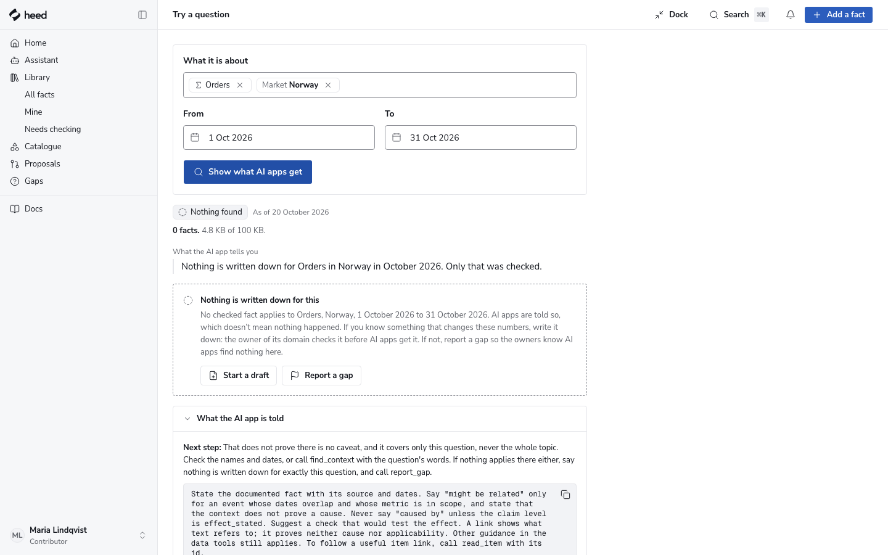
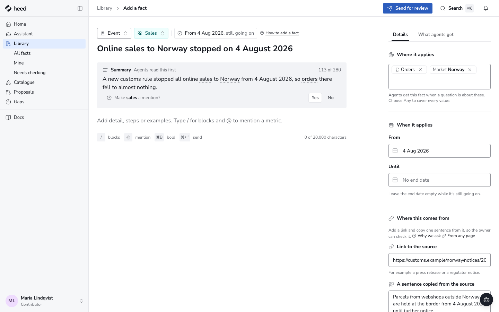
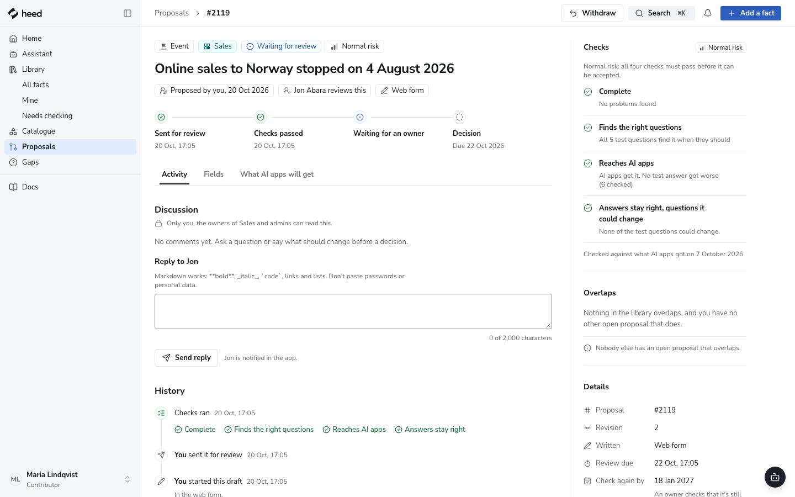
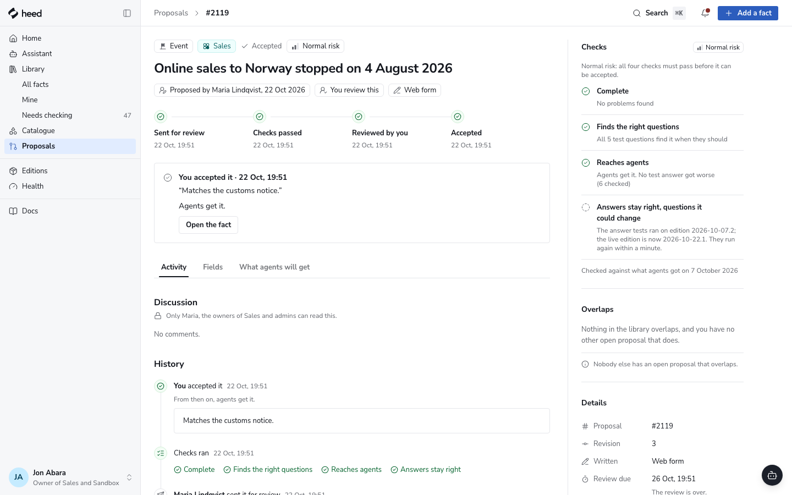
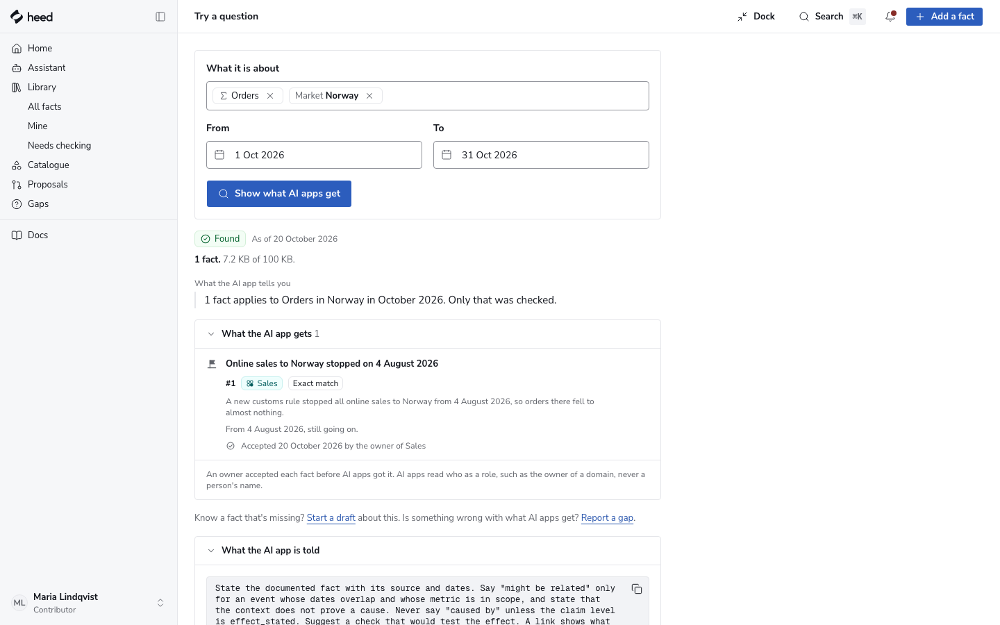
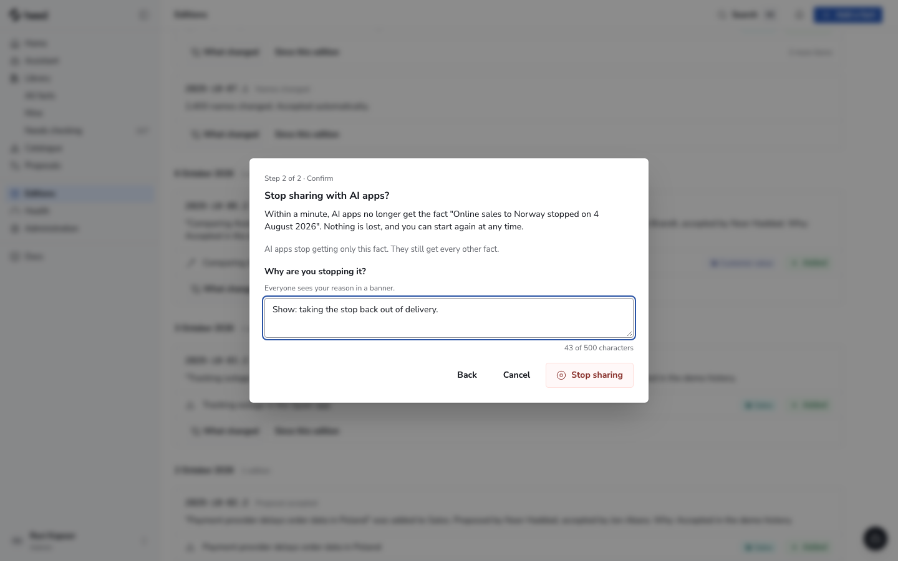
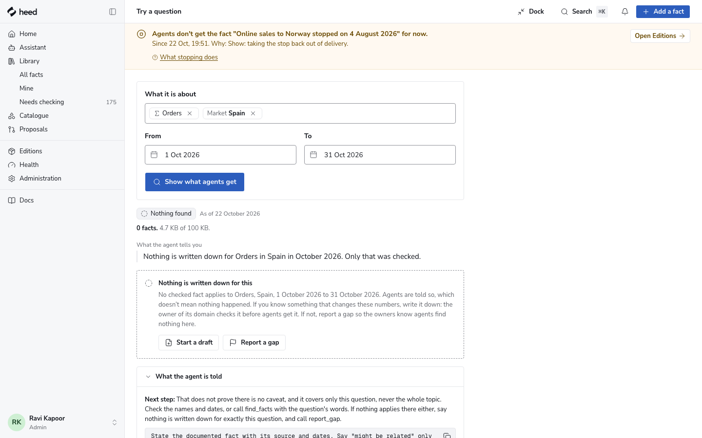

# The Norway show

A five-minute story, told side by side: Heed in the browser on the left, Claude Code on the right.
An agent finds nothing about orders in Norway. Maria writes the fact down, the checks run,
Jon accepts it, and Claude answers with the fact, its source and who reviewed it. An administrator
stops its delivery and Claude stops getting it within a minute. Asked about Spain, Claude says
plainly that Heed has nothing written down.

It runs on the demo data (twelve real countries as markets, and invented metrics and people), on its own database and ports,
apart from `docker compose up` and the dev servers. Everything here is local and spends nothing:
the models are the scripted mock. It needs Node and the local PostgreSQL 18 ([Run the service locally](operations.md#run-the-service-locally)).

| What           | Where                                                                              |
| -------------- | ---------------------------------------------------------------------------------- |
| Web app        | http://localhost:5300                                                              |
| Service        | http://127.0.0.1:3300 (Claude Code connects to its `/mcp`)                         |
| Database       | `heed_demo` on your local PostgreSQL 18                                            |
| Keys and build | `~/.heed-demo`; the logs are in the terminal that runs `npm run demo`              |
| The people     | Maria Lindqvist (writes), Jon Abara (owner of Sales) , Ravi Kapoor (administrator) |

## Every day until the show: the daily check

```sh
npm run demo:check
```

It runs the whole show headless, on a database and ports of its own (3310 and 5310), and ends with
`The Norway show runs end to end.` or, in capitals, which step broke. Each step below is one
step of the check (`tests/demo/norway.spec.ts`), so a failure names the step you would have
stumbled on. It takes about two minutes on a quiet machine and leaves nothing behind (`-- --keep`
keeps its database to look at). `-- --screenshots docs/demo` takes the pictures on this page again.

What it cannot do is run Claude itself: it asks Heed exactly what Claude Code asks, through the
same MCP connection, and checks what Claude reads.

## Before the show (ten minutes)

1. Build the show fresh and start it: `npm run demo`, in a terminal of its own. It takes about a
   minute, replaces `heed_demo` (so everything from a rehearsal goes), and prints the addresses
   and the line that connects Claude Code once it runs. Leave it running for the show.
2. Open a second terminal for Claude Code.
3. Connect Claude Code to the show, from a folder of its own so it uses this Heed and no other:

   ```sh
   mkdir -p ~/norway-show && cd ~/norway-show
   claude mcp add --transport http heed-demo http://localhost:3300/mcp
   claude
   ```

   In Claude Code, run `/mcp`, choose **heed-demo**, then **Authenticate**. The browser opens the
   show's sign-in: choose Maria Lindqvist, then **Allow**. Each `npm run demo` ends this sign-in,
   so do it after the show has started.

4. In the browser, open http://localhost:5300 and sign in as **Maria Lindqvist**. Put the browser
   on the left half of the screen and Claude Code on the right.

## The show

### 1. What an agent gets today (Maria, Claude)

In Claude Code, ask:

> How did orders in Norway change in October 2026?

**Expect:** Claude asks Heed and says _nothing is written down for orders in Norway_ in
October, that only that was checked, and that it has no data tool for the numbers. It may
list background items a search by words found (the definition of Orders, notes about other
markets); the line to point at is "nothing written down".

In the browser, on **Home**, choose **Try a question**. In **What it is about**, type `Orders`
and choose it, then type `Norway` and choose it. Set **From** to `1 Oct 2026` and **To** to
`31 Oct 2026`, then choose **Show what agents get**.

**Expect:** **No match**, _0 delivered_, and **No fact applies to this scope**: the same nothing
Claude got, shown without running a model.



### 2. Maria writes the fact (Maria)

Choose **Start a draft**. The form opens with the kind **Event**, the domain **Sales** and
Orders and Norway already under **Where it applies**. Type:

| Field                                 | What to type                                                                                                      |
| ------------------------------------- | ----------------------------------------------------------------------------------------------------------------- |
| **Title**                             | Online sales to Norway stopped on 4 August 2026                                                                   |
| **Summary**                           | A new customs rule stopped all online sales to Norway from 4 August 2026, so orders there fell to almost nothing. |
| **From** (under **When it applies**)  | 4 Aug 2026 (leave **Until** empty)                                                                                |
| **Link to the source**                | https://customs.example/norway/notices/2026-08-04                                                                 |
| **A sentence copied from the source** | Parcels from webshops outside Norway are held at the border from 4 August 2026 until further notice.              |
| **Date you read it**                  | choose **Today**                                                                                                  |
| **What not to conclude**              | Fewer orders in Norway after 4 August do not mean fewer customers. (or choose **Use this**)                       |

Optionally open the **What agents get** tab to show what an agent will get once it is accepted.



### 3. The checks run (Maria)

Choose **Send for review**.

**Expect:** the proposal's page, **Waiting for review**, with **Checks passed** on its progress line
and, under **Checks**, **Complete**, **Finds the right questions**, **Reaches agents** and
**Answers stay right** all passed. Point at **Finds the right questions**: Heed tried the questions
this fact should and should not answer before anyone relies on it.



### 4. Jon accepts it (Jon)

Open the menu under Maria's name, choose **Switch demo person**, choose **Jon Abara** and
**Continue as Jon Abara**. Heed comes back to the same proposal, now with Jon's decision bar:
_Your decision, as owner of Sales_. Choose **Accept**, type the reason
`Matches the customs notice.` and choose **Accept**. (From anywhere else: **Proposals**, then
the proposal under **To review**.)

**Expect:** _From then on, agents get it._, with the new edition (the day's date and a
number), and the progress line ends with _Reviewed by you_ and **Accepted**.



### 5. Claude answers with the fact (Claude, Maria)

In Claude Code, ask the same question again:

> How did orders in Norway change in October 2026?

**Expect:** Claude names the stop from 4 August 2026, cites the customs notice, says that fewer
orders do not mean fewer customers, and says who reviewed it: accepted by the owner of Sales,
with the edition, never the person's name.

Optionally, switch back to Maria and choose **Show what agents get** on Try it again: the fact
is now **Found**, as #1 under **What the agent gets**.



### 6. Stop delivery (Ravi)

Switch demo person to **Ravi Kapoor**. Open **Editions**. On the live edition, open **More
actions for this edition**, choose **Stop sharing…**, then **One fact**, find _Online sales to
Norway stopped on 4 August 2026_ and choose **Continue**. Under **Why are you stopping it?**,
type `Show: taking the stop back out of delivery.` and choose **Stop sharing**.

Ask Claude the Norway question again.

**Expect:** within a minute (on this machine, at once), Claude no longer gets the fact: it says one
fact matches but it is no longer shared. Nothing is deleted and no edition is made, and the
edition's menu brings it back.



### 7. An honest nothing (Claude)

In Claude Code, ask:

> How did orders in Spain change in October 2026?

**Expect:** Claude says _nothing is written down for orders in Spain_ in October, and that
only that was checked. It does not borrow the Norway fact. Try it on Spain shows **No
match** too, with the sentence Claude was given to say.



## After the show

Ctrl+C in the show's terminal stops it; the next `npm run demo` builds it fresh. The show never
touches `docker compose up` (ports 3000 and 8080), the dev servers or the test servers.

## If something goes wrong

- **The daily check fails.** The last lines name the step and what it expected. The trace of the
  failed step is in `test-results/demo` (`npx playwright show-trace <file>` replays it screen by
  screen). Run it again with `-- --keep` to keep its database, `heed_demo_check`, to look at; the
  next run replaces it.
- **Try it finds something for Norway before Maria writes.** The show was not reset after a
  rehearsal: stop it with Ctrl+C and run `npm run demo` again.
- **Claude Code asks another Heed, or none.** Start it from `~/norway-show`, and check `/mcp`
  lists **heed-demo** as connected. After each `npm run demo`, **Authenticate** again.
- **A port is taken.** `HEED_DEMO_PORT` and `HEED_DEMO_WEB_PORT` move the show,
  `PW_DEMO_API_PORT` and `PW_DEMO_WEB_PORT` the check. Change Claude Code's address to match.

## How the show data differs from the demo seed

The show is the demo seed (`npm run seed`) with a clean slate where the story happens:
the items that would answer orders in Norway or Spain in October 2026, and the demo's
invented stops of online sales to those two markets on other days, are left out
(`db/seed/norway.ts`). On the plain demo seed, Try it finds general notes on orders for both
markets, and a search by words finds stops that contradict Maria's. Everything else is the
same: 1,482 items, the quality history, Health and the gaps.

